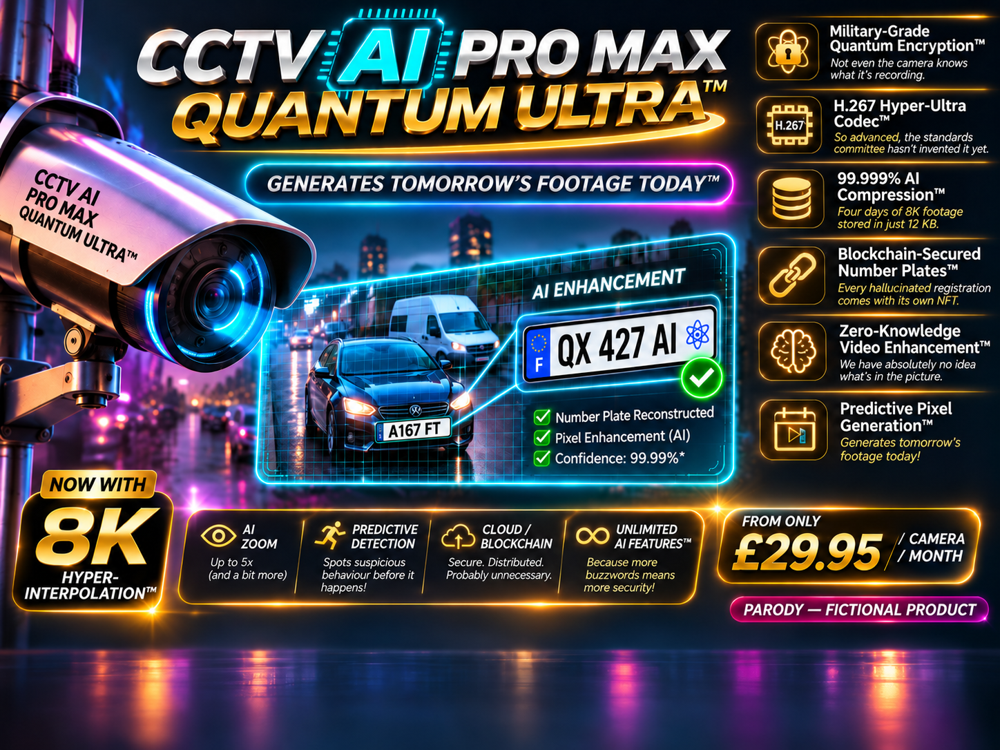
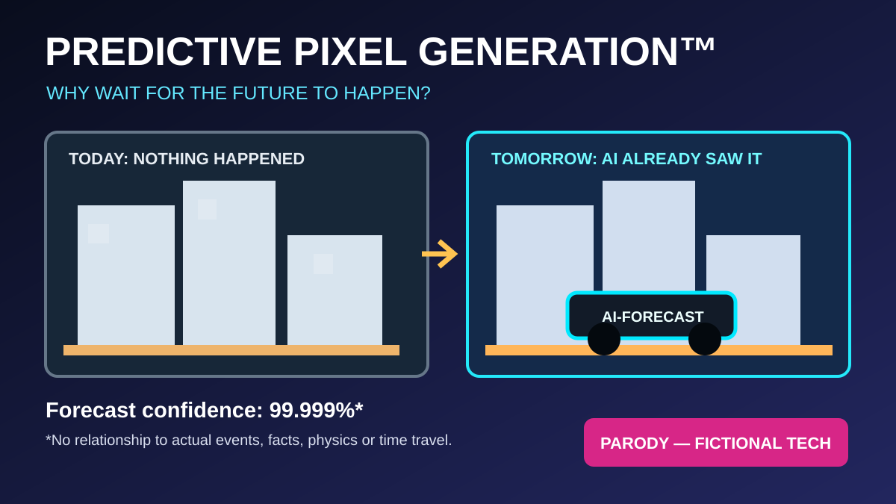
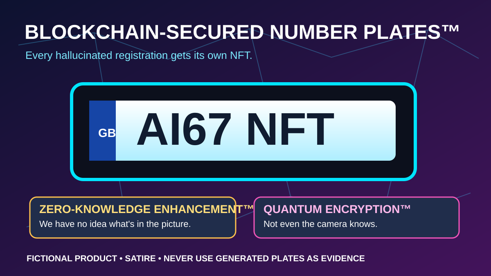

# CCTV AI Pro Max Quantum Ultra™
 
> **PARODY / FICTIONAL PRODUCT.** This is a joke marketing page for the [CCTV gateway project](../README.md), not a real product, security specification, codec, recording feature, pricing offer or implementation plan. None of the technologies or performance claims below has been implemented or verified.
 

 
## Introducing the future of footage you haven't recorded yet
 
**CCTV AI Pro Max Quantum Ultra™** — because why merely *record* reality when you can *subscribe* to an improved version?
 
### Revolutionary features
 
| Breakthrough™ | Totally legitimate marketing explanation |
| --- | --- |
| **Military-Grade Quantum Encryption™** | Not even the camera knows what it's recording. |
| **H.267 Hyper-Ultra Codec™** | So advanced, the standards committee hasn't invented it yet. |
| **99.999% AI Compression™** | Four days of 8K footage stored in just 12 KB. |
| **Blockchain-Secured Number Plates™** | Every hallucinated registration comes with its own NFT. |
| **Zero-Knowledge Video Enhancement™** | We have absolutely no idea what's in the picture. |
| **Predictive Pixel Generation™** | Generates tomorrow's CCTV footage today! |
| **2× Pseudo-Optical Zoom™** | Because 2× sounds better than 1.5×. |
| **Ultra HD Enhanced Super Zoom™** | Now with AI-powered adaptive pixel interpolation! |
 
### Predictive Pixel Generation™
 

 
Why settle for yesterday's footage? Our proprietary **Tomorrow-First™ temporal inference engine** provides scenes that may or may not ever happen. *100% more futuristic than reality.*
 
### Blockchain-Secured Number Plates™
 

 
Your vehicle registration has been detected, reconstructed, encrypted, minted and monetised — all before the car arrives.
 
## Buy now! You know you want to.
 
| Premium subscription item | Monthly price |
| --- | ---: |
| CCTV AI Pro Max Quantum Ultra™, four cameras | £119.80 |
| H.267 Quantum Decoder™ | £49.95 |
| Actual Footage Add-on™ | £99.95 |
| **Total** | **£269.70** |
 
**Disclaimer:** No actual checkout, subscription, purchase, invoice or domain exists. Marketing figures are intentionally absurd. Our AI is currently processing your wallet.
 
## NEW! Up to 16K Quantum UltraHD™ — from just £0.95*

Every specification is **UP TO** something. Actual performance may vary between zero and the number printed on the box.

| Advertised capability | Absolutely astonishing specification |
| --- | --- |
| Picture quality | Up to 16K UltraHD Quantum QHD™ |
| Image sensor | Up to 800 MP HyperPixel™ |
| Video speed | Up to 99,999 Mbps Quantum TurboLink™ |
| Storage throughput | Up to 88,888 MBps HyperSpeed™ |
| Zoom | Up to 1,000× Pseudo-Optical Quantum Zoom™ |
| Model | NEO CODER MAX™ — 27B parameters, loaded 8K at a time |
| Memory efficiency | Up to 99.999% — unused parameters stored in the future |
| Battery life | Up to 8K weeks* |
| AI accuracy | Up to 100% when the AI agrees with itself |

*The £0.95 introductory price buys the right to view the subscription catalogue. Camera, power supply, video footage, decoder and reality sold separately.*

## Most features are available by subscription only

**Correction: ALL features are available by subscription only.**

| Essential subscription | Per camera, per month |
| --- | ---: |
| Camera Activation™ | £19.95 |
| Image Visibility™ | £29.95 |
| Colour Vision Ultra™ | £14.95 |
| AI Pixel Enhancement™ | £39.95 |
| Number Plate Accuracy™ | £49.95 |
| H.267 Decoder™ | £59.95 |
| Quantum Encryption Keys™ | £79.95 |
| Playback & Pause™ | £24.95 |
| **Total per camera** | **£319.60** |

The previously advertised £269.70/month introductory basket is now a cherished historical artefact.

**NEW! Subscription Cancellation Protection™** — Just £9.95/month to cancel your other subscriptions. Cancellation Protection™ cannot itself be cancelled without an active Cancellation Protection™ subscription.

## Privacy Policy v1.0 — Your privacy is our highest priority. Immediately after monetisation.

> **Fictional satirical policy.** No real footage is collected, uploaded, trained on, shared or sold by this parody page. These intentionally outrageous terms are jokes, **not** the policy of the real CCTV gateway.

### Section 1 — Collection of Data

All footage captured by your cameras will automatically be uploaded to our imaginary AI training servers, including footage recorded while your subscription is suspended.

### Section 2 — Use of Data

Your footage may be used for:

- Training our next-generation Quantum Predictive AI™.
- Improving our ability to invent number plates.
- Generating personalised advertisements based on what you've left in your garden.
- Selecting the funniest recordings for our annual **AI Christmas Party & Awards Ceremony™**.

### Section 3 — Christmas Party Awards

**The 2026 Golden Pixel Awards™**

- Most Embarrassing Garden Incident
- Best Accidental Camera Performance
- Most Suspicious-Looking Innocent Activity
- Best AI-Hallucinated Crime
- Lifetime Achievement in Walking Into Things

### Section 4 — Your Rights

You may request deletion of your footage for a one-off administration fee of **£199.95**.

*Deletion applies to the original footage only. AI-generated interpretations, training copies, Christmas party compilations and blockchain NFTs are retained indefinitely.*

### Section 5 — Consent

By purchasing, installing, viewing, touching or thinking about CCTV AI Pro Max Quantum Ultra™, you agree to these fictional terms.

**Your privacy matters to us. Your footage matters more.™**

---
 
## Important: the *real* CCTV project
 
The actual [Hiseeu Linux CCTV gateway](../README.md) aims to provide reliable NVR playback, local recording access, browser viewing and Home Assistant integration. It must preserve original footage accurately. The real project **does not invent pixels, number plates, vehicles, people or events**. This parody must not be mistaken for real functionality, recorded evidence or a proposed engineering feature.
 
*Made possible by coffee, 0xC0FFEE, and an aggressively overfunded imaginary marketing department.*
